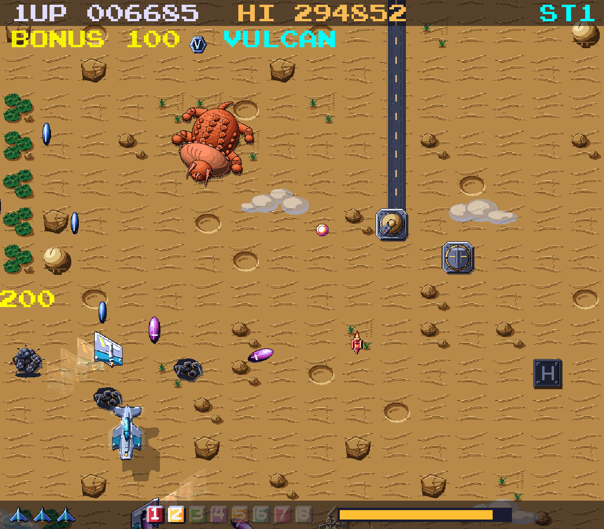
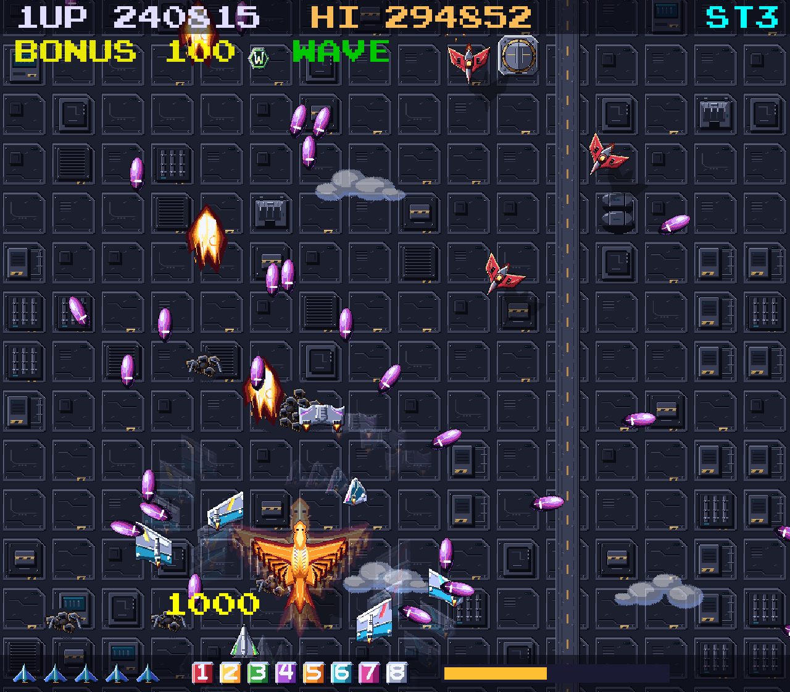
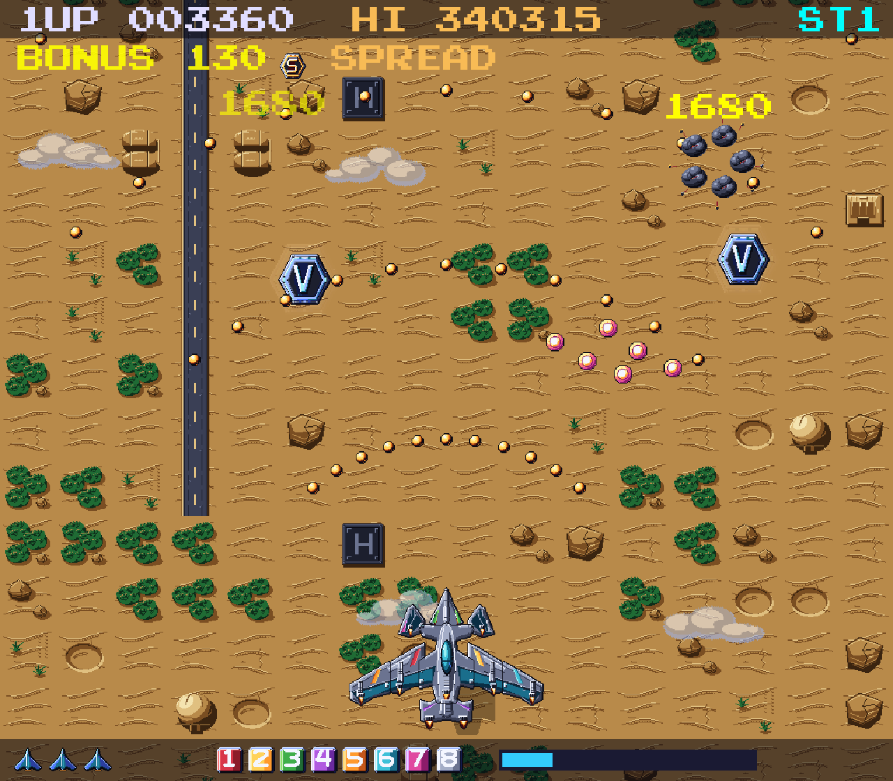
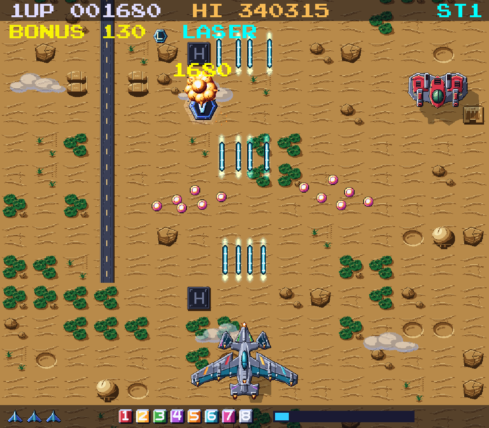
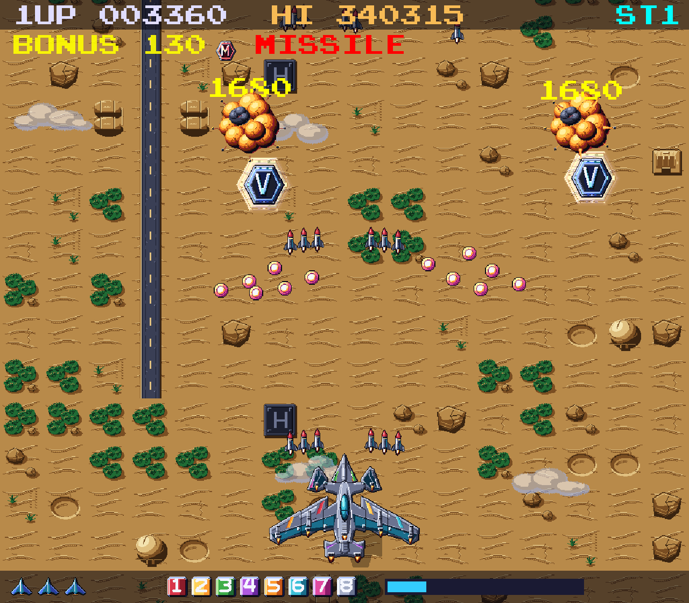
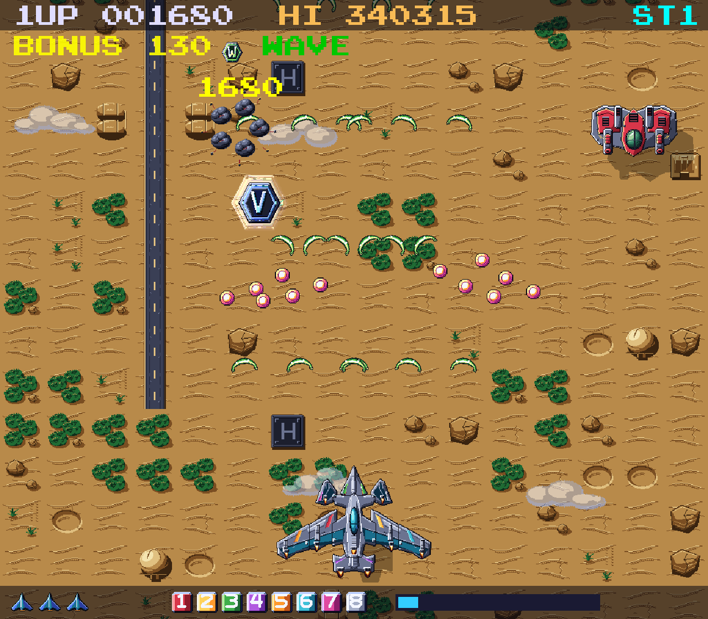

# Eight Wings


A complete vertically scrolling arcade shooter in **C11 on the [sdl-2d-game-engine](https://github.com/andrealaforgia/sdl-2d-game-engine)** (SDL2 underneath, via the engine), made as a tribute to Nichibutsu's 1985 *Terra Cresta*:
numbered ground bunkers release eight different modules that **dock** onto your ship and visibly reshape it, walking **dinosaurs** stomp the ground and leave their bones behind, a gauge-powered
**formation attack** splits the ship apart (or turns it into a phoenix at full assembly), and each of three stages ends in a boss.
All graphics are generated procedurally (by OpenAI Codex, driven by Claude Code) at 4 texels per logical pixel, and all audio is synthesised by script.
No third-party art, sound or sprite sheets are used.

## Gameplay video

[](https://www.youtube.com/watch?v=GOJIQbyPfhc)

[Watch a full playthrough on YouTube](https://www.youtube.com/watch?v=GOJIQbyPfhc): all three stages and bosses, flown by the demo pilot (invulnerable, so it can show everything).

## Screenshots

Real captures from the running game (`make screenshots`).

| | |
|---|---|
|  |  |
| All eight modules docked | Formation attack |
|  |  |
| Walking dinosaurs | Defeated dinosaurs leave bones |
|  |  |
| Boss 1 | Stage 3 fortress |
|  |  |
| A charging triceratops | Weavers, hunters and more |
|  |  |
| Spread weapon | Laser weapon |
|  |  |
| Homing missiles | Wave weapon |


## Build and run

Requirements: a C11 compiler, `make`, SDL2 and SDL2_image (used by the engine), Python 3 (stdlib only; cooks the sprite atlas and regenerates art/audio).
The engine is a git submodule: clone with `git clone --recurse-submodules git@github.com:andrealaforgia/eight-wings.git` (or run `make install`).

macOS: `brew install sdl2 sdl2_image`; Linux (Debian/Ubuntu): `sudo apt-get install build-essential libsdl2-dev libsdl2-image-dev`

```sh
make            # build ./eight-wings
make run        # play
make test       # unit + scenario tests (headless) and asset validation
make sanitize   # the same tests under AddressSanitizer + UBSan
make assets     # regenerate all pixel art + atlas (python3 tools/gen_assets.py && tools/pack_atlas.py)
make audio      # regenerate all sound and music
make screenshots# capture real gameplay screenshots into screenshots/ (opens a window briefly)
```

Generated assets and audio are committed, so a fresh checkout builds and runs without running the generators.
Build system note: like `super-fabio-bro`, the engine is built by its own makefile and consumed through its library and public headers; the game never includes SDL. CMake is not installed on the
development machine and was not used.

### Options
The window opens as tall as the usable screen, with the width following the playfield's proportions so there are no side bars (`--width=N --height=N` to override, `F` or F11 for full screen). Options: `--seed=N` (deterministic run) `--stage=1..3` `--god` `--debug` `--no-audio` `--assets=DIR` `--autoshots=DIR` `--help`.

**Recording a playthrough.** `python3 tools/record_video.py out.mp4` plays a full run with the demo pilot (invulnerable, so it shows every stage and boss), pipes the frames to ffmpeg and mixes the sound from the game's own WAV files using a log of the sound events. About 5 minutes, 768x672, 30 fps.

**Fire discipline bonus.** Kill points are multiplied by up to x2.0 for players who fire in bursts and only x1.0 for those who hold the fire button down; it follows how much of the last three seconds the trigger was held, and the current multiplier is shown under the score as a percentage (BONUS 100 to BONUS 200).

**Weapon types.** Hexagonal capsules (dropped by gunships, bombers, splitters and the big dinosaurs) switch your weapon; dying resets it to the Vulcan. Every type has five tiers, one per pair of docked modules, so docking still makes every weapon bigger:

| Weapon | Shape | Tiers |
|---|---|---|
| Vulcan (V) | straight shots | needle, twin bolts, trident with a lance, piercing lance fan, plasma ball (the second module of each pair adds escort shots) |
| Spread (S) | a short-range fan of pellets | 3, 5, 7, 9, 11 pellets; pierces at the top tier |
| Laser (L) | fast piercing beams | 1, 2, 3, 3, 4 beams |
| Missile (M) | homing missiles that burst out sideways and curve onto targets | 2, 2, 4, 4, 6 missiles |
| Wave (W) | piercing crescents snaking up in counter-phase | 2, 2, 4, 4, 6 crescents |

**Enemies.** Besides drones, swoopers, wingmen, divers, spinners, saucers and bombers: weavers (sine-wave chains), hunters (homing darts), gunships (park overhead, fire bursts, always drop a weapon capsule) and splitters (burst into three attackers). **Dinosaurs:** raptors and rexes, plus three big ones: the triceratops stalks, shakes and charges, the spinosaurus spits aimed volleys, and the sauropod stomps out rings of shock-orbs. All leave skeletons behind.

## Controls
| Action | Keys |
|---|---|
| Move (8 directions) | Arrow keys or WASD |
| Fire | Space or Z |
| Formation attack | X or Shift |
| Pause / menu (resume, music & SFX volume, mute, quit to title) | Esc |
| Start / restart | Enter |
| Mute | M |
| Fullscreen | F |
| Debug overlay (hitboxes, entity counts, docking/formation state, seed) | F3 |

The controls are also shown in-game (Esc on the title screen, and during the attract loop).

## Documentation
* [docs/GAMEPLAY.md](docs/GAMEPLAY.md) mechanics: docking, formation attack, bosses, scoring
* [docs/ARCHITECTURE.md](docs/ARCHITECTURE.md) subsystems, decisions, what was reused from super-fabio-bro
* [docs/ASSET_GENERATION.md](docs/ASSET_GENERATION.md) how Claude Code and Codex produced the art; how to reproduce it
* [AUTONOMOUS_PROGRESS.md](AUTONOMOUS_PROGRESS.md), [DELIVERY_REPORT.md](DELIVERY_REPORT.md)
