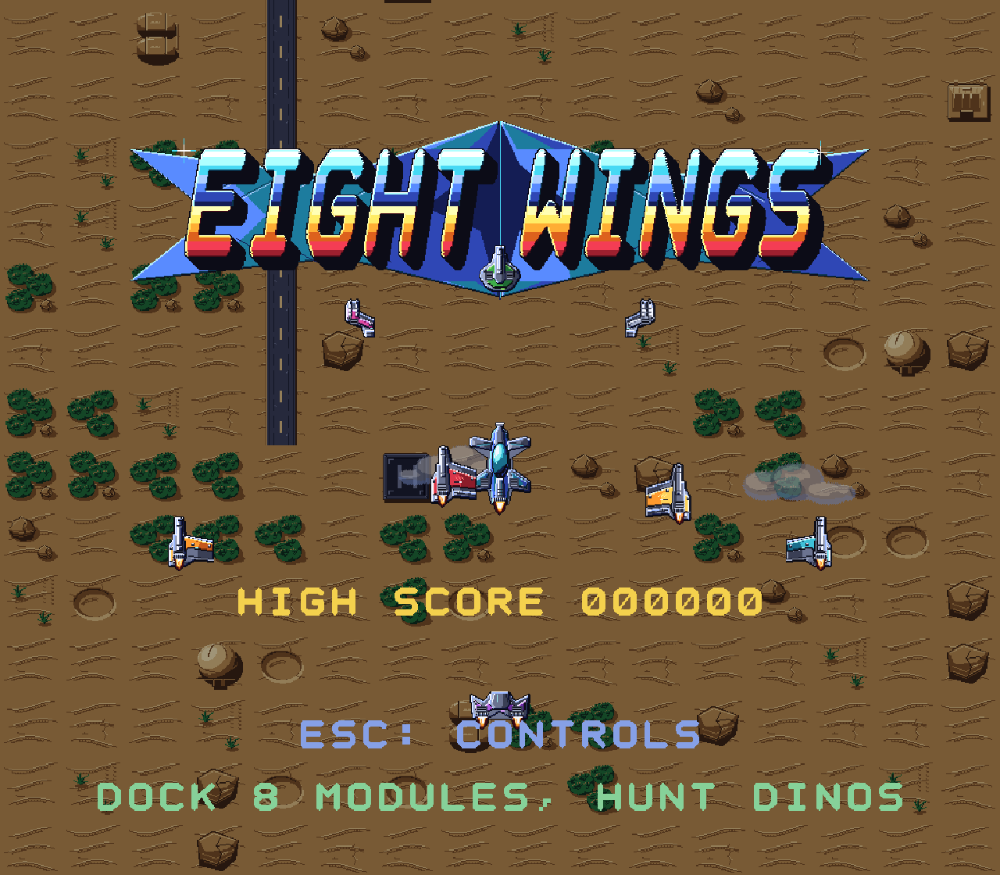
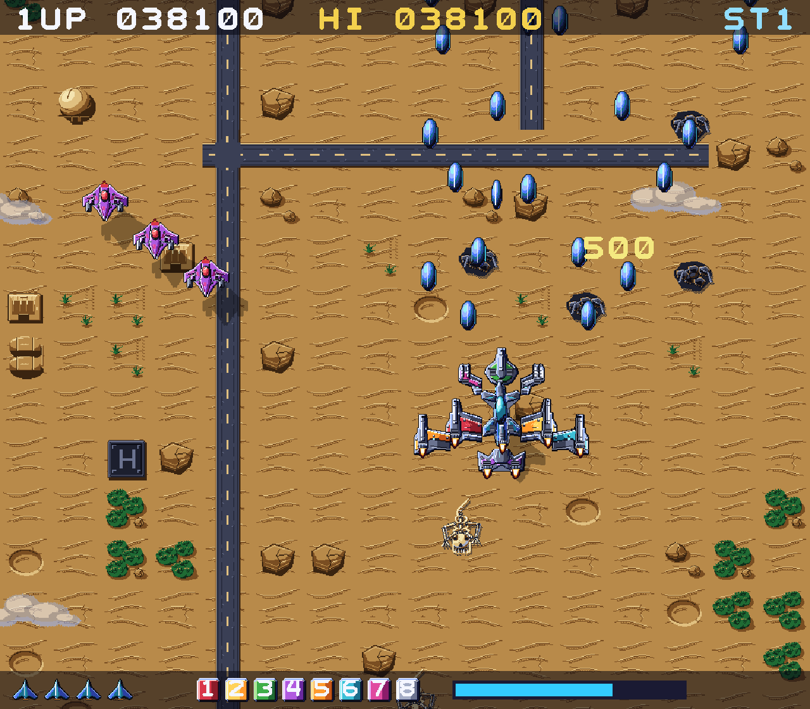
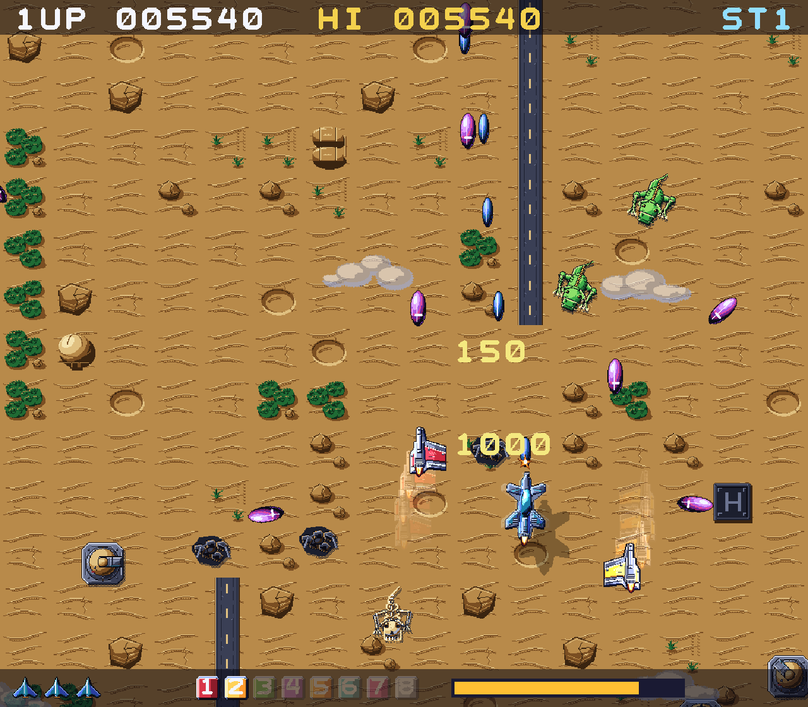
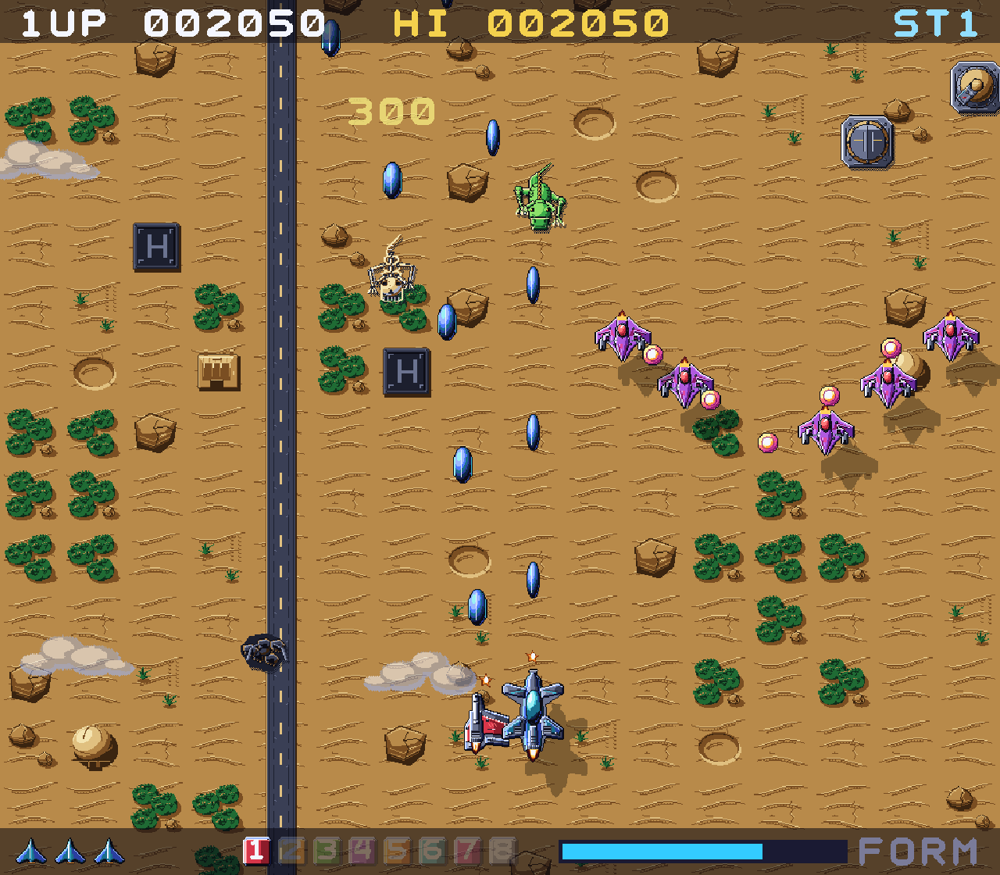
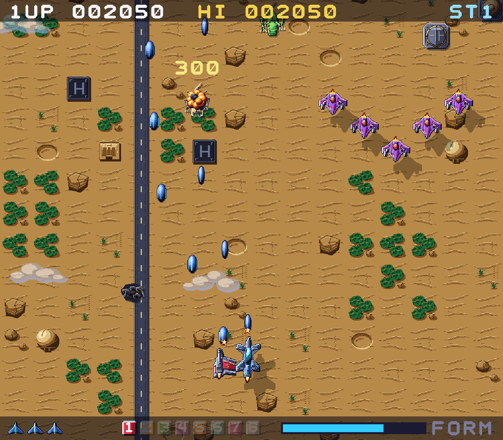
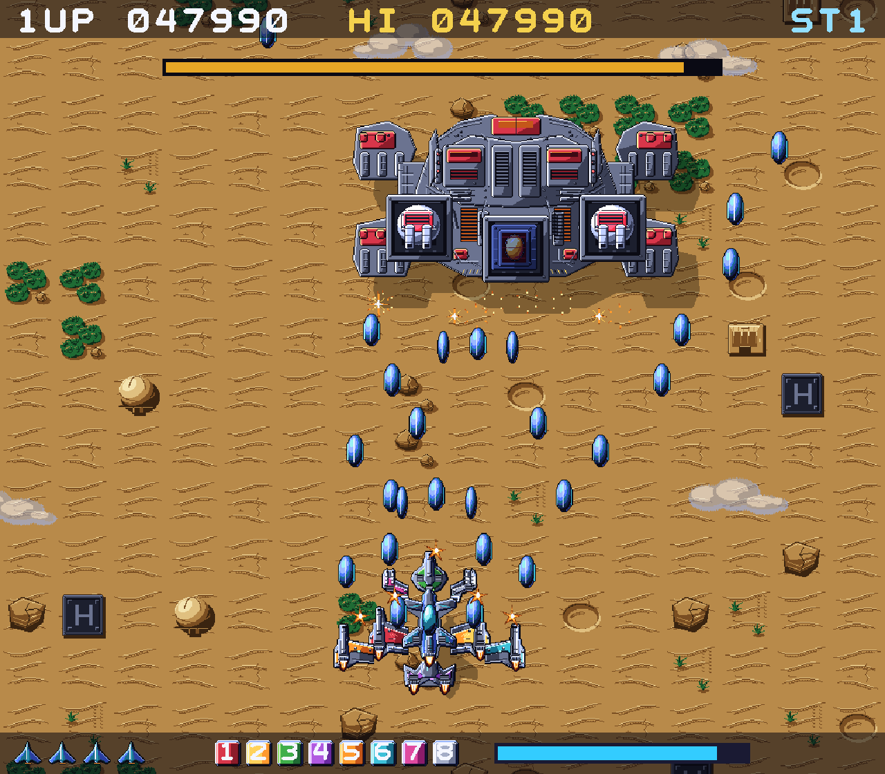
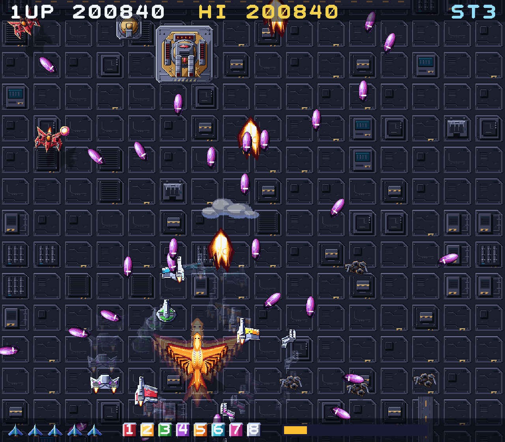

# Eight Wings



A complete vertically scrolling arcade shooter in **C11 on the [sdl-2d-game-engine](https://github.com/andrealaforgia/sdl-2d-game-engine)** (SDL2 underneath, via the engine), made as a tribute to Nichibutsu's 1985 *Terra Cresta*:
numbered ground bunkers release eight different modules that **dock** onto your ship and visibly reshape it, walking **dinosaurs** stomp the ground and leave their bones behind, a gauge-powered
**formation attack** splits the ship apart (or turns it into a phoenix at full assembly), and each of three stages ends in a boss.
All graphics are generated procedurally (by OpenAI Codex, driven by Claude Code) at 4 texels per logical pixel, and all audio is synthesised by script.
No third-party art, sound or sprite sheets are used.

## Screenshots

Real captures from the running game (`make screenshots`).

| | |
|---|---|
|  |  |
| All eight modules docked | Formation attack |
|  |  |
| Walking dinosaurs | Defeated dinosaurs leave bones |
|  |  |
| Boss 1 | Stage 3 fortress |


## Build and run

Requirements: a C11 compiler, `make`, SDL2 and SDL2_image (used by the engine), Python 3 (stdlib only; cooks the sprite atlas and regenerates art/audio).
The engine is a git submodule: clone with `git clone --recurse-submodules git@github.com:andrealaforgia/eight-wings.git` (or run `make install`).

macOS: `brew install sdl2 sdl2_image`; Linux (Debian/Ubuntu): `sudo apt-get install build-essential libsdl2-dev libsdl2-image-dev`

```sh
make            # build ./eight-wings
make run        # play
make test       # unit + scenario tests (headless) and asset validation
make sanitize   # the same tests under AddressSanitizer + UBSan
make assets     # regenerate all pixel art + atlas (python3 tools/gen_assets.py && tools/pack_atlas.py)
make audio      # regenerate all sound and music
make screenshots# capture real gameplay screenshots into screenshots/ (opens a window briefly)
```

Generated assets and audio are committed, so a fresh checkout builds and runs without running the generators.
Build system note: like `super-fabio-bro`, the engine is built by its own makefile and consumed through its library and public headers; the game never includes SDL. CMake is not installed on the
development machine and was not used.

### Options
The window opens as large as fits your desktop (`--scale N` to override, `F` for fullscreen). `--seed N` (deterministic run) `--stage 1..3` `--god` `--debug` `--scale N` `--fullscreen` `--no-audio` `--assets DIR` `--autoshots DIR` `--help`

## Controls
| Action | Keys |
|---|---|
| Move (8 directions) | Arrow keys or WASD |
| Fire | Space or Z |
| Formation attack | X or Shift |
| Pause / menu (resume, music & SFX volume, mute, quit to title) | Esc |
| Start / restart | Enter |
| Mute | M |
| Fullscreen | F |
| Debug overlay (hitboxes, entity counts, docking/formation state, seed) | F3 |

The controls are also shown in-game (Esc on the title screen, and during the attract loop).

## Documentation
* [docs/GAMEPLAY.md](docs/GAMEPLAY.md) mechanics: docking, formation attack, bosses, scoring
* [docs/ARCHITECTURE.md](docs/ARCHITECTURE.md) subsystems, decisions, what was reused from super-fabio-bro
* [docs/ASSET_GENERATION.md](docs/ASSET_GENERATION.md) how Claude Code and Codex produced the art; how to reproduce it
* [AUTONOMOUS_PROGRESS.md](AUTONOMOUS_PROGRESS.md), [DELIVERY_REPORT.md](DELIVERY_REPORT.md)
